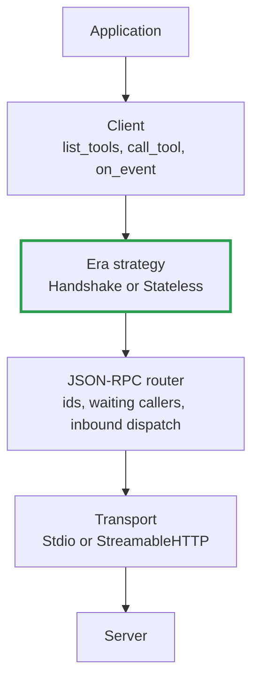
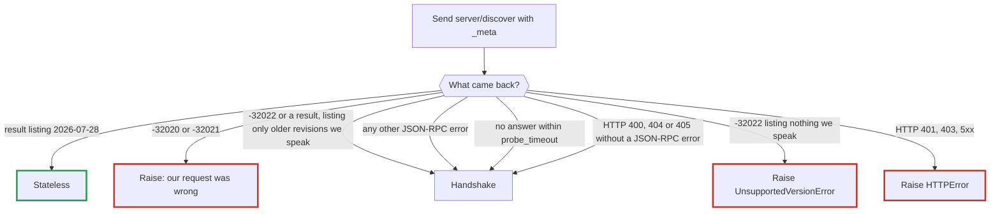
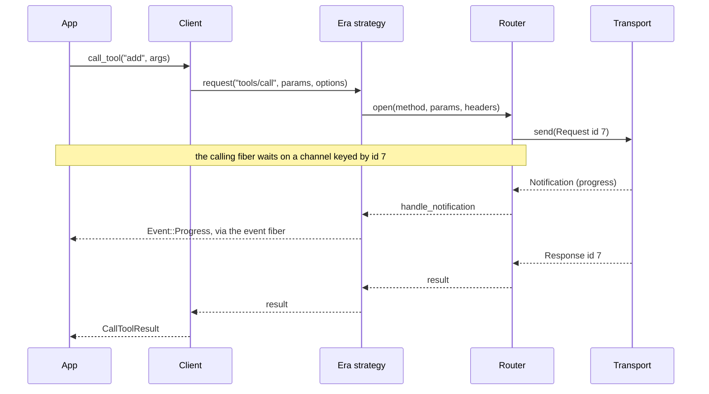
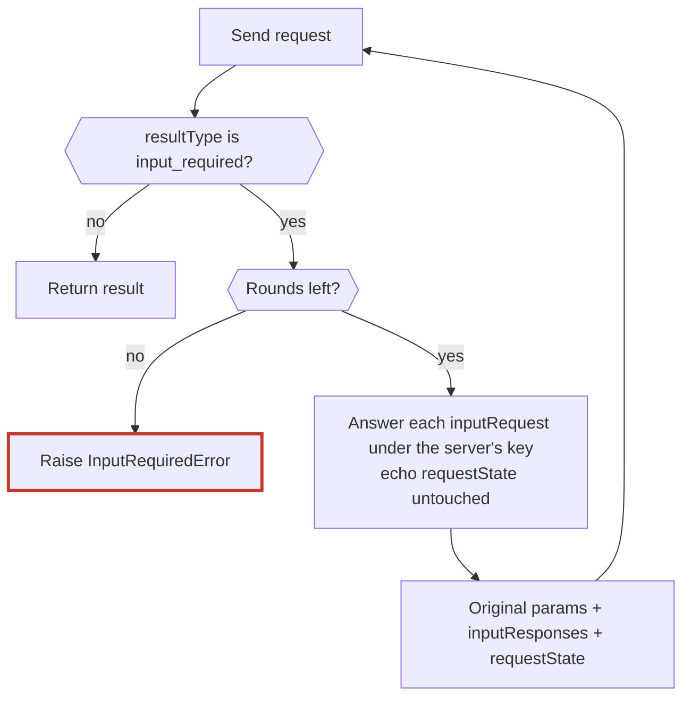
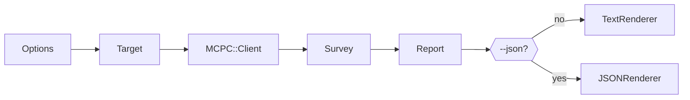

# MCP client design

This document says how the shard is put together and why. Read [README.md](README.md) first for
what it does from the outside.

## The problem in one paragraph

MCP has two eras that disagree about nearly everything except the JSON-RPC envelope. In the
handshake era (2024-11-05 to 2025-11-25) a connection opens with `initialize` and the server may
send requests back to the client. In the stateless era (2026-07-28) there is no opening, every
request describes itself, and the server asks for input by having the request retried. An
application should not care which it is talking to.

## Layers

Each layer knows nothing about the ones above it. Era differences live in one layer.

| Layer | Files | Owns |
|---|---|---|
| Client | `client.cr`, `pagination.cr`, `types/` | The public methods, typed results, following cursors |
| Era | `era/` | Handshake or `_meta`, routing headers, how input is requested, how cancellation is said |
| JSON-RPC | `json_rpc/` | Message shapes, request ids, matching responses to callers |
| Transport | `transport.cr`, `transport/` | Bytes: a subprocess's pipes, or HTTP POSTs and event streams |

Beside the stack sit the pieces the application touches directly: `Event` and `EventDispatcher`,
`ClientInput` with the elicitation types, `Subscription`, `RequestOptions`, `Cancellation`,
`Config` and `errors.cr`.

## Connecting: which era?

`Era::Detector` decides once per connection, and the decision is never revisited.

The rule from the specification: a recognised modern error means "modern server, bad request".
Anything else means "old server". The fallback is deliberately not keyed to one error code,
because old servers answer an unknown first request however they like, or not at all.

## The life of a request

### Fibers

The brief's rule D5 is followed: one fiber reads and routes, and callers wait on a channel keyed
by request id.

| Fiber | Started by | Job |
|---|---|---|
| Caller | The application | Sends a request and blocks in `Call#await` |
| Reader | `Transport::Stdio#open` | Reads lines and hands each message to the router |
| Request | `Transport::StreamableHTTP#send` | One per HTTP request; reads that request's reply |
| Events | `EventDispatcher` | Calls the application's handler, in order |
| Server request | `Era::ServerRequests` | One per question from a handshake-era server |
| Subscription | `Era::Stateless#subscribe` | Waits for a listen stream to end |

Two consequences are worth remembering.

1. The reader fiber must never block on the application. That is why events go through
   `EventDispatcher` and elicitation runs on its own fiber. Without this, a handler that called
   `client.list_tools` would wait for a response the blocked reader could never deliver.
2. `Router#open` takes a block that runs after the caller is registered and before the request is
   sent. `Stateless` uses it to register a listen stream before the server can acknowledge it.

## What each era does

| Concern | `Era::Handshake` | `Era::Stateless` |
|---|---|---|
| Opening | `initialize`, then `notifications/initialized` | Nothing; `server/discover` was the probe |
| Request metadata | None | `RequestMeta` adds version, client info, capabilities, log level to `_meta` |
| HTTP headers | `MCP-Protocol-Version` | `RoutingHeaders`: version, `Mcp-Method`, `Mcp-Name`, `Mcp-Param-*` |
| Server needs input | Server sends `elicitation/create`; `ServerRequests` replies | `MultiRoundTrip` retries the request with `inputResponses` |
| Cancellation | `notifications/cancelled` | Close the HTTP stream, or `notifications/cancelled` on stdio |
| Subscriptions | `resources/subscribe` per URI; list changes come unasked | One `subscriptions/listen` request, tracked by `ListenStream` |
| Log level | `logging/setLevel` once | `_meta` on every request |

Both eras answer elicitation through the same `ClientInput`, and turn notifications into events
through the same `NotificationEvents`. That is what keeps the application's code identical.

### Multi-round-trip requests

Each round starts from the original params, so state from one round cannot leak into a round
whose result carried none. A result without a `resultType` counts as complete, which lets the same
code path serve responses shaped like the older revisions.

### Routing headers and `x-mcp-header`

Over HTTP, a 2026-07-28 server may mark tool arguments to be mirrored into `Mcp-Param-*` headers.
`RoutingHeaders#learn` reads those marks from each tool that `list_tools` returns, and
`HeaderAnnotations` validates them. A tool with invalid marks is left out of `list_tools`, as the
specification requires. On stdio there is no header layer, so nothing is filtered.

A tool called without having been listed gets no `Mcp-Param-*` headers.

## Transports

`Transport` is a small abstract class: `open`, `send`, `close`, and three callbacks. Three
optional methods let an era use what a transport can do without knowing what kind it is.

| Method | Stdio | StreamableHTTP |
|---|---|---|
| `uses_headers?` | false | true |
| `abort(id)` | false: cannot | true: closes that request's stream |
| `listen(headers)` | does nothing | opens the handshake era's GET stream |

`StreamableHTTP` keeps the `Mcp-Session-Id` itself. It is a property of the HTTP conversation, and
keeping it there spares the era layer from reading response headers.

`HTTPReply` classifies a refusal. A JSON-RPC error in the body becomes `RPCError` even with an
HTTP error status, because modern servers send both. The exceptions are 401 and 403, which stay
`HTTPError` so that an authorization failure is never mistaken for an old server.

## Decisions and their costs

| Decision | Why | Cost |
|---|---|---|
| One event handler taking a typed `Event` | A new event never changes the client's method list | The app writes a `case` |
| Events on their own fiber, queue of 1024 | Handlers may call the client | A handler that never returns eventually blocks the reader |
| Elicitation is a separate handler, not an event | It must return an answer | Two registration methods instead of one |
| Typed results convert through `to_json`/`from_json` | Short, obviously correct | Each result is serialized twice |
| Unknown JSON fields are dropped from typed results | Small structs | Use `Client#request` to see everything |
| A new `HTTP::Client` per request | Trivial cancellation by closing it | No connection reuse |
| `list_*` always returns every page | Simplest thing for callers | No lazy paging for very large lists |
| No runtime dependencies | Easy to adopt and audit | SSE and header encoding are hand-written, about 60 lines |

## Not built

| Missing | Notes |
|---|---|
| OAuth 2.1 | Pass a token in `headers` for now. A project of its own. |
| HTTP+SSE transport (2024-11-05) | Deprecated. It would be a third `Transport` subclass. |
| Sampling, roots | Deprecated in 2026-07-28. `ClientInput#answer` is where they would go. |
| URL-mode elicitation | Only form mode is declared, so servers should not send it. |
| Tasks extension | Not started. |
| `completion/complete` as a typed method | Works today through `Client#request`. |
| Caching by `ttlMs` and `cacheScope` | Results are never cached. |
| SSE resumption with `Last-Event-ID` | Handshake era only; dropped from the protocol in 2026-07-28. |
| Re-initializing an expired HTTP session | `SessionExpiredError` is raised; make a new client. |
| Restarting a stdio server that exits | `Event::Disconnected` is emitted; make a new client. |
| Retrying after `-32020` by re-listing tools | The error is raised as `RPCError`. |
| Retrying a request after `-32022` mid-connection | The revision is settled at `connect`. |
| The official conformance suite | Build step 8 of the brief. |

## How to extend

**Add an event.** Add a struct under `Event` in `event.cr`, then a `when` in
`NotificationEvents.translate`. Nothing else changes.

**Add a typed method.** Add it to `Client`, building params and decoding the result inside
`decoding(method) { ... }` so that a malformed result raises `ProtocolError`.

**Add a transport.** Subclass `Transport`. Call `deliver` for each inbound message, `fail(id,
error)` when a request can never be answered, and `closed` once at the end. Add a constructor to
`Client` if it deserves one.

**Add an app.** Make a folder under `apps/` with a `main.cr`, add a `targets:` entry to
`shard.yml`, and put specs under `spec/apps/`. Use only the public API.

**Add a protocol revision.** If it follows an existing era, add it to `Protocol`. If it changes the
conversation, write a new `Era::Strategy` and teach `Era::Detector` to choose it. The layers below
should not need to change.

## Apps

`apps/` holds command-line tools that ship with the shard. They sit above the stack as ordinary
applications: they use the public API and nothing else, which makes each one a standing test that
the API is enough.

They are built by `shards build` and are not handed to projects that depend on the shard. Doing
that needs a `postinstall` compile on every install of every dependent, wanted or not.

### mcpc-probe

Connects to one server and reports what it advertises.

| Class | Job |
|---|---|
| `Options` | Reads the command line; resolves header values from the environment |
| `HTTPTarget`, `StdioTarget` | Know how to build the client for one kind of server |
| `Survey` | Connects, then reads each list the server advertises, recording failures instead of raising |
| `Report`, `Section`, `Item` | Plain data: what was found |
| `Diagnosis` | Turns an error into advice a person can act on |
| `TextRenderer`, `JSONRenderer` | Write the report |
| `CleanText` | Strips control characters from server-written text before it reaches a terminal |
| `CLI` | Wires the above and chooses the exit status |

`Survey` asks only for lists whose capability the server advertises, so a failure always means
the server offered something this client could not read.

## Authority

When this document, the code and the specification disagree, the specification wins:
`schema/<revision>/schema.ts` first, then `docs/specification/<revision>/`, in
[modelcontextprotocol/modelcontextprotocol](https://github.com/modelcontextprotocol/modelcontextprotocol).
The notes in `references/` come third.
