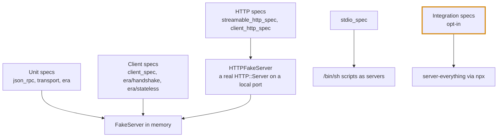

# Developing MCP Client

How to build, test and change this shard. For how it works, see [DESIGN.md](DESIGN.md).

## Dependencies

1. Make sure you have Crystal toolchain installed.
  - via `brew install crystal` for macOS and Linux (if you are so inclined)
  - or directly [install Crystal](https://crystal-lang.org/install/) from the website
2. Make sure you have `ops` installed, in one of the following ways:
  - as a gem via `gem install ops_team` or
  - as a tool via `brew tap nickthecook/crops && brew install ops`

## Using `ops`

Command               |Description                                                            
----------------------|-----------------------------------------------------------------------
`ops up`              |Gets everything setup, especially dependencies and `ameba` for linting.
`ops specs`           |Run `crystal spec` on the test specs in `spec/`                        
`ops lint`            |Run `ameba` on the source code                                         
`ops build`           |Build the command-line apps into `bin/`                                
`ops integration`     |Run the specs that need the reference server (Node and network)        
`ops test`            |Convenient actions to run tests specs and lint the code                
`ops wipe`            |Clear Crystal build caches                                             
`ops run CRYSTAL_FILE`|Build and run a Crystal app                                            

## Using `crystal` directly

### Dependency check

Run the following to update dependencies and build `ameba` first time or when dependency updates.
```sh
shards check || (shards install && mkdir -p bin && cp lib/ameba/bin/ameba.cr bin && crystal build -o bin/ameba bin/ameba.cr)
```
### Build and test

Command                      |Description                   
-----------------------------|------------------------------
`crystal --order random spec`|Run test specs in random order
`bin/ameba src spec samples apps`|Lint all source code       
`shards build`               |Build the command-line apps into `bin/`
`crystal tool format`        |Format all source code        
`crystal clear_cache`        |Clear Crystal build caches    
`crystal run CRYSTAL_FILE`   |Build and run a Crystal app   

## Where things are

Path                |Holds
--------------------|----------------------------------------------------------------------
`src/mcpc.cr`       |The requires, in dependency order
`src/mcpc/`         |One small class or module per file; [DESIGN.md](DESIGN.md) maps them to layers
`spec/`             |Specs, mirroring `src/mcpc/`
`spec/support/`     |The fake servers the specs run against
`spec/fixtures/`    |Example messages copied from the MCP specification
`spec/integration/` |Specs against the real reference server
`samples/`          |Runnable examples
`apps/`             |Command-line apps that ship with the shard, one folder each
`spec/apps/`        |Their specs
`references/`       |Notes on the protocol and the build brief

## Testing

### How the specs are arranged



1. `FakeServer` is a scripted MCP server. Register a block per method and its value becomes the
   result. `FakeServer.legacy` and `FakeServer.modern` start you off with a server of each era.
2. `FakeTransport` connects a client to a `FakeServer` in memory and records what was sent.
3. `HTTPFakeServer` serves the same `FakeServer` over real HTTP, as JSON or as an event stream.
4. `client_spec.cr` runs its shared examples once per era. Behaviour that must not differ between
   eras belongs there.

### Things that will bite you

1. A `FakeServer` handler that only raises does not compile into a working proc. Use
   `server.fail_with(method, code, message)` to script an error.
2. Use `wait_until { ... }` rather than `sleep` when waiting on another fiber.
3. Never `not_nil!` in specs; `params_of(request)` and `result_of(response)` say what was missing.

### Integration specs

They run the reference server with `npx`, so they need Node and a network. They are pending unless
you opt in:

```sh
MCPC_INTEGRATION=1 crystal spec --tag integration
```

### Fixtures

`spec/fixtures/2026-07-28/` is a copy of `schema/2026-07-28/examples/` from the
[specification repository](https://github.com/modelcontextprotocol/modelcontextprotocol). Copy the
directory again to refresh it. Do not edit the files.

## Working on the code

1. **Check the specification first.** Before writing or changing a message, read its type in
   `schema/<revision>/schema.ts`. Never invent a field.
2. **Compile everything.** Crystal only type-checks code that is called, so a method without a
   spec has not been checked at all.
3. **Keep classes small.** One job per class, one class per file. If a method needs a paragraph of
   comments, split it.
4. **Comments describe use and outcome.** Say what a type or method is for and what it returns.
   Inside a method, comment only to list the steps. History goes in commit messages.
5. **Keep the eras apart.** Anything that differs between protocol eras belongs in `src/mcpc/era/`.
   `Client`, the router and the transports must not ask which era they are in.
6. **Spell acronyms in capitals**, as the standard library does: `MCPC`, `HTTPError`, `JSONRPC`,
   `SSEReader`. File names stay in snake case: `json_rpc/`, `sse_reader.cr`.
7. **Never pretty-print** JSON that goes to a server. On stdio a newline ends the message.
8. **Before you commit**, run the following, and expect no output from the middle two.

```sh
crystal spec --order random
crystal tool format --check
bin/ameba src spec samples apps
```

### Apps

An app under `apps/` is a customer of the shard, not part of it.

1. It requires `src/mcpc` and uses only what an outside application could: the public API.
   If an app needs something the API lacks, improve the API.
2. Nothing in `src/` may require anything in `apps/`.
3. Each app has a `main.cr` that only starts it, and a `targets:` entry in `shard.yml`.
   Everything else lives in small classes that specs can load without running the app.
4. Text written by a server is untrusted. Before printing it to a terminal, pass it through
   something like `MCPCProbe::CleanText`, which removes control characters.

### Continuous integration

`.github/workflows/ci.yml` runs on every pull request and on every push to `main`.

Job               |Runs                                                  |On
------------------|------------------------------------------------------|------------------------------------------
Specs             |`crystal spec --order random`                         |Linux, macOS, Windows × Crystal 1.20, 1.21, latest
Format and lint   |`shards build`, the format check, then `ameba`        |Linux, latest Crystal
Reference server  |The integration specs, against `server-everything`    |Linux, macOS, Windows, latest Crystal

1. The oldest Crystal in the matrix is the one `shard.yml` promises. Change them together.
2. The reference-server job downloads from npm on each run, so it can fail for reasons that have
   nothing to do with your change. Re-run it before looking for a bug.
3. Specs must run on Windows: start helper processes through `sh` found on the `PATH`, never by
   an absolute Unix path, and find fixtures with `fixture_paths`, because a glob pattern cannot
   hold Windows path separators.

### Keeping the documents current

Document                  |Update it when
--------------------------|---------------------------------------------------------------
[README.md](README.md)    |Anything an application can see changes: methods, events, errors, config
[DESIGN.md](DESIGN.md)    |A layer, a decision or the "Not built" list changes
DEVELOPMENT.md            |The way to build, test or lint changes

## Contributions

By invitation only for the time being.
