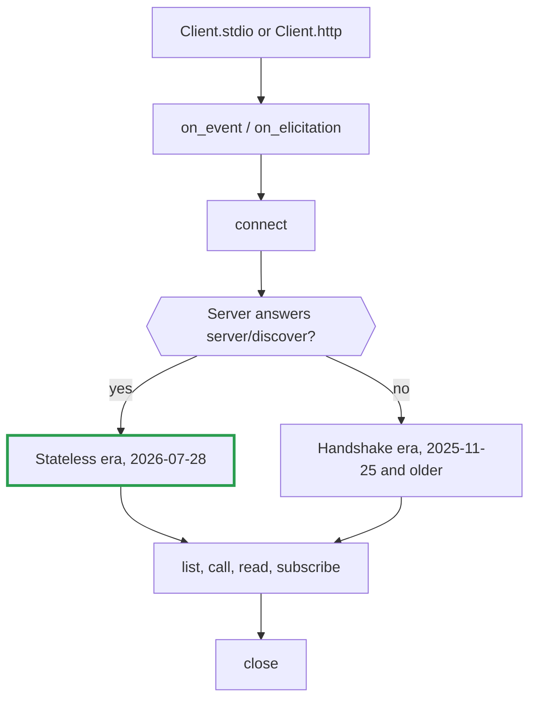

# mcpc.cr

An MCP client as a Crystal shard. It talks to [Model Context Protocol](https://modelcontextprotocol.io)
servers over stdio or Streamable HTTP, and hides which revision of the protocol the server speaks.

Think of it as a travel adaptor: your app has one plug, and the shard works out which socket is in the wall.

## Install

Add the shard to `shard.yml`, then run `shards install`.

```yaml
dependencies:
  mcpc:
    github: nogginly/mcpc.cr
```

It needs Crystal 1.22 or later and nothing beyond the standard library.

## Quick start

```crystal
require "mcpc"

client = Mcpc::Client.stdio("npx", ["-y", "@modelcontextprotocol/server-everything"])
client.connect

client.list_tools.each { |tool| puts tool.name }

result = client.call_tool("echo", {"message" => "hello"})
puts result.text

client.close
```

For a remote server, swap the first line. The rest stays the same.

```crystal
client = Mcpc::Client.http("https://example.com/mcp", {"Authorization" => "Bearer #{token}"})
```

A runnable version is in [`samples/everything.cr`](samples/everything.cr).

## How a session goes



`connect` returns a `ServerInfo`: the revision in use, the server's name, its capabilities and its
instructions. Your code is the same on both branches.

## What you can ask a server

| Method | Returns |
|---|---|
| `list_tools` | `Array(Tool)`, every page |
| `call_tool(name, arguments)` | `CallToolResult` |
| `list_resources` | `Array(Resource)` |
| `list_resource_templates` | `Array(ResourceTemplate)` |
| `read_resource(uri)` | `Array(ResourceContents)` |
| `list_prompts` | `Array(Prompt)` |
| `get_prompt(name, arguments)` | `PromptResult` |
| `subscribe(filter)` | `Subscription` |
| `request(method, params)` | raw `JSON::Any`, for anything not listed above |

Each call blocks the calling fiber until the answer arrives. Run calls in separate fibers to make
them concurrent.

### Tool results

A tool that fails is not an exception. It returns a result with `error?` set, so a model can read
the reason and try again.

```crystal
result = client.call_tool("get_weather", {"city" => "Atlantis"})
if result.error?
  puts "tool failed: #{result.text}"
else
  result.content.each do |block|
    case block
    when Mcpc::TextContent      then puts block.text
    when Mcpc::ImageContent     then save(block.data, block.mime_type)
    when Mcpc::ResourceLink     then puts "see #{block.uri}"
    when Mcpc::EmbeddedResource then puts block.resource.text
    end
  end
  puts result.structured_content
end
```

## Events

Register one handler. It receives everything the server or the connection reports unasked.

```crystal
client.on_event do |event|
  case event
  when Mcpc::Event::Progress           then puts "#{event.token}: #{event.progress} of #{event.total}"
  when Mcpc::Event::LogMessage         then puts "[#{event.level}] #{event.data}"
  when Mcpc::Event::ToolsChanged       then tools = client.list_tools
  when Mcpc::Event::PromptsChanged     then prompts = client.list_prompts
  when Mcpc::Event::ResourcesChanged   then resources = client.list_resources
  when Mcpc::Event::ResourceUpdated    then client.read_resource(event.uri)
  when Mcpc::Event::SubscriptionClosed then puts "subscription ended: #{event.reason}"
  when Mcpc::Event::Disconnected       then puts "connection lost: #{event.reason}"
  end
end
```

Events arrive in order on a fiber of their own, so the handler may call the client, as above.

## Per-request options

```crystal
cancellation = Mcpc::Cancellation.new
options = Mcpc::RequestOptions.new(
  timeout: 30.seconds,        # instead of Config#request_timeout
  progress_token: "import-1", # ask for Event::Progress carrying this token
  cancellation: cancellation, # lets another fiber give up on the call
)

spawn { client.call_tool("import", {"file" => "big.csv"}, options) }
cancellation.cancel("user pressed stop")   # the call raises Mcpc::CancelledError
```

A call that times out or is cancelled is also cancelled on the server.

## Answering a server's questions

A tool may need something from the user halfway through, such as a confirmation. Register a handler
**before** `connect`; servers are told the client can answer only if one exists by then.

```crystal
client.on_elicitation do |request|
  puts request.message              # written by the server: untrusted
  puts request.requested_schema     # JSON Schema of the fields wanted
  request.accept({"guests" => 4})   # or request.decline, or request.cancel
end
```

The two protocol eras ask in different ways. The handler is the same for both.

## Change notifications

```crystal
filter = Mcpc::SubscriptionFilter.new(tools: true, resource_uris: ["file:///notes/todo.md"])
subscription = client.subscribe(filter)
subscription.filter   # what the server agreed to send
# ... Event::ToolsChanged and Event::ResourceUpdated now arrive at on_event ...
subscription.close
```

Handshake-era servers send list changes without being asked, so you may see those events before
subscribing.

## Errors

Everything raised is an `Mcpc::Error`.

| Error | Meaning |
|---|---|
| `RpcError` | The server refused the request. Has `code` and `data`. |
| `TimeoutError` | No answer in time. |
| `CancelledError` | Your `Cancellation` was cancelled. |
| `InputRequiredError` | The server wants input and there is no handler, or it kept asking. |
| `ProtocolError` | The server sent something malformed. |
| `UnsupportedVersionError` | Client and server share no protocol revision. |
| `TransportError` | The server could not be reached. |
| `ConnectionClosedError` | The connection ended mid-request. A `TransportError`. |
| `HttpError` | An HTTP refusal such as 401. Has `status` and `body`. A `TransportError`. |
| `SessionExpiredError` | The HTTP session is gone; make a new client. An `HttpError`. |
| `NotConnectedError` | Called before `connect` or after `close`. |

## Configuration

```crystal
config = Mcpc::Config.new
config.client_name = "my-app"
config.client_version = "1.2.0"
config.request_timeout = 20.seconds  # default 60 s
config.probe_timeout = 2.seconds     # default 5 s; see below
config.max_input_rounds = 4          # default 8
config.log_level = "warning"         # ask for Event::LogMessage at this level and above

client = Mcpc::Client.stdio("my-server", config: config)
```

`probe_timeout` is how long `connect` waits for an older server to react to the modern greeting
before falling back. A stdio server that ignores unknown requests costs you that long, once.

To send a stdio server's stderr somewhere other than your own, build the transport yourself:

```crystal
transport = Mcpc::Transport::Stdio.new("my-server", stderr: File.open("server.log", "a"))
client = Mcpc::Client.new(transport)
```

## Trust

Tool descriptions, prompts, annotations, `ServerInfo#instructions` and elicitation messages are
written by the server. Show them or pass them to a model as untrusted input. The shard never acts
on them.

## What it covers

| | |
|---|---|
| Protocol revisions | 2026-07-28 (stateless), and 2025-11-25, 2025-06-18, 2025-03-26, 2024-11-05 (handshake) |
| Transports | stdio, Streamable HTTP |
| Server features | tools, resources, resource templates, prompts, logging, progress, cancellation, subscriptions |
| Client features | form-mode elicitation |

Not built yet: OAuth, the deprecated HTTP+SSE transport, sampling, roots, URL-mode elicitation and
the tasks extension. [DESIGN.md](DESIGN.md) lists the rest and says why.

## More

- [DESIGN.md](DESIGN.md): how it works inside.
- [DEVELOPMENT.md](DEVELOPMENT.md): building, testing and contributing.
