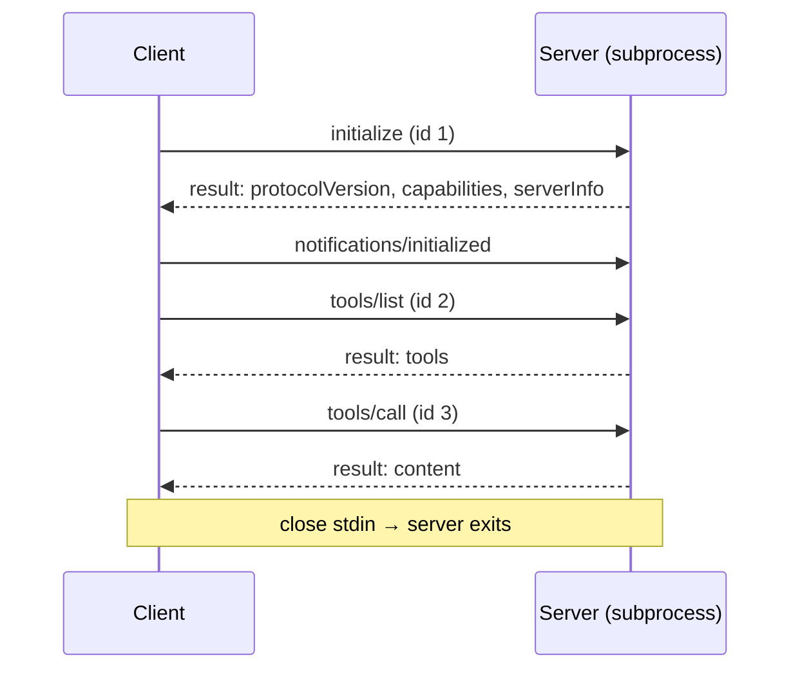

# 2. stdio, handshake era (2024-11-05 → 2025-11-25)

[← Index](README.md)

The client spawns the server as a subprocess. Messages are **newline-delimited JSON** on stdin/stdout. stderr is free-form logging. `curl` can't help here; Crystal can.



## Step 1 — initialize

Client → server:
```json
{"jsonrpc":"2.0","id":1,"method":"initialize","params":{
  "protocolVersion":"2025-11-25",
  "capabilities":{"elicitation":{}},
  "clientInfo":{"name":"crmcp","version":"0.1.0"}}}
```

Server → client:
```json
{"jsonrpc":"2.0","id":1,"result":{
  "protocolVersion":"2025-11-25",
  "capabilities":{"tools":{"listChanged":true}},
  "serverInfo":{"name":"demo","version":"1.0.0"},
  "instructions":"Optional hints for the model."}}
```

Negotiation rule: the server replies with your version if it supports it, otherwise **its own latest**. If you can't speak that one, disconnect.

## Step 2 — initialized (notification, no reply)

```json
{"jsonrpc":"2.0","method":"notifications/initialized"}
```

## Step 3 — use it

```json
{"jsonrpc":"2.0","id":2,"method":"tools/list","params":{}}
```

## Crystal client

```crystal
require "json"

# Minimal stdio MCP client. Spawns `cmd`, performs the handshake,
# and exposes `request` (blocking) and `notify`.
class StdioClient
  getter server_info : JSON::Any = JSON::Any.new(nil)

  def initialize(cmd : String, args = [] of String)
    @proc = Process.new(cmd, args, input: :pipe, output: :pipe, error: :inherit)
    @next_id = 0
  end

  def handshake(version = "2025-11-25") : JSON::Any
    result = request("initialize", {
      "protocolVersion" => version,
      "capabilities"    => {} of String => String,
      "clientInfo"      => {"name" => "crmcp", "version" => "0.1.0"},
    })
    notify("notifications/initialized")
    @server_info = result
  end

  # Sends a request and returns its `result`; raises on `error`.
  # Inbound server requests and notifications are handled while waiting.
  def request(method : String, params = {} of String => String) : JSON::Any
    id = (@next_id += 1)
    send({"jsonrpc" => "2.0", "id" => id, "method" => method, "params" => params})
    loop do
      line = @proc.output.gets || raise "server closed stdout"
      msg = JSON.parse(line)
      if msg["method"]?
        handle_inbound(msg)
      elsif msg["id"]? == id
        raise "MCP error: #{msg["error"]}" if msg["error"]?
        return msg["result"]
      end
    end
  end

  def notify(method : String, params = {} of String => String)
    send({"jsonrpc" => "2.0", "method" => method, "params" => params})
  end

  def close
    @proc.input.close
    @proc.wait
  end

  private def send(obj)
    @proc.input.puts(obj.to_json)
    @proc.input.flush
  end

  # Steps: reply "method not found" to server requests (they have an id);
  # ignore notifications (no id).
  private def handle_inbound(msg : JSON::Any)
    return unless id = msg["id"]?
    send({"jsonrpc" => "2.0", "id" => id,
          "error" => {"code" => -32601, "message" => "not supported"}})
  end
end

c = StdioClient.new("npx", ["-y", "@modelcontextprotocol/server-everything"])
pp c.handshake
pp c.request("tools/list")
c.close
```

## Caveats

1. JSON must not contain raw newlines; `to_json` is compact, so you're safe. Pretty-printing breaks framing.
2. Anything a server prints to stdout that isn't JSON-RPC (a stray `puts`) corrupts the stream. Servers must log to stderr.
3. Don't send anything except `ping` before `initialize` gets its response.
4. Shutdown has no message: close stdin, wait, then SIGTERM, then SIGKILL.
