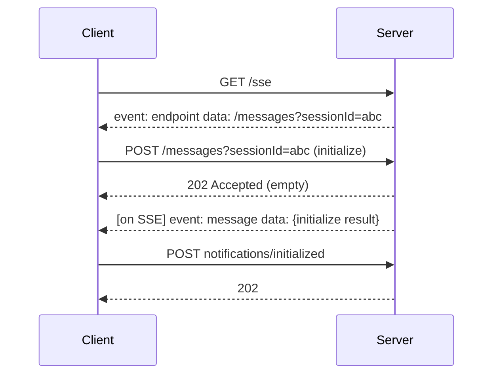

# 3. HTTP+SSE (2024-11-05) — deprecated, still deployed

[← Index](README.md)

Two endpoints. The client opens a long-lived **GET** stream; the server tells it where to **POST**. Replies arrive on the stream, not in the POST response. Like ordering at a counter and being told to wait for your number to be called over the tannoy.



## Step 1 — open the stream (terminal A)

```bash
curl -N -H 'Accept: text/event-stream' http://localhost:3001/sse
```
```
event: endpoint
data: /messages?sessionId=abc123
```

## Step 2 — initialize (terminal B)

```bash
curl -i -X POST 'http://localhost:3001/messages?sessionId=abc123' \
  -H 'Content-Type: application/json' \
  -d '{"jsonrpc":"2.0","id":1,"method":"initialize","params":{
       "protocolVersion":"2024-11-05","capabilities":{},
       "clientInfo":{"name":"curl","version":"1"}}}'
```
```
HTTP/1.1 202 Accepted
```
Terminal A now shows:
```
event: message
data: {"jsonrpc":"2.0","id":1,"result":{"protocolVersion":"2024-11-05","capabilities":{"tools":{}},"serverInfo":{"name":"demo","version":"1.0.0"}}}
```

## Step 3 — initialized, then tools/list (terminal B)

```bash
curl -X POST 'http://localhost:3001/messages?sessionId=abc123' \
  -H 'Content-Type: application/json' \
  -d '{"jsonrpc":"2.0","method":"notifications/initialized"}'

curl -X POST 'http://localhost:3001/messages?sessionId=abc123' \
  -H 'Content-Type: application/json' \
  -d '{"jsonrpc":"2.0","id":2,"method":"tools/list"}'
```
The `id:2` result appears in terminal A.

## Caveats

1. The `endpoint` data may be relative or absolute; resolve it against the SSE URL.
2. Closing the GET stream ends the session. Keep it open for the life of the connection.
3. Supporting this is only worth it as the last fallback for a client (see [08](08-compatibility.md)).
