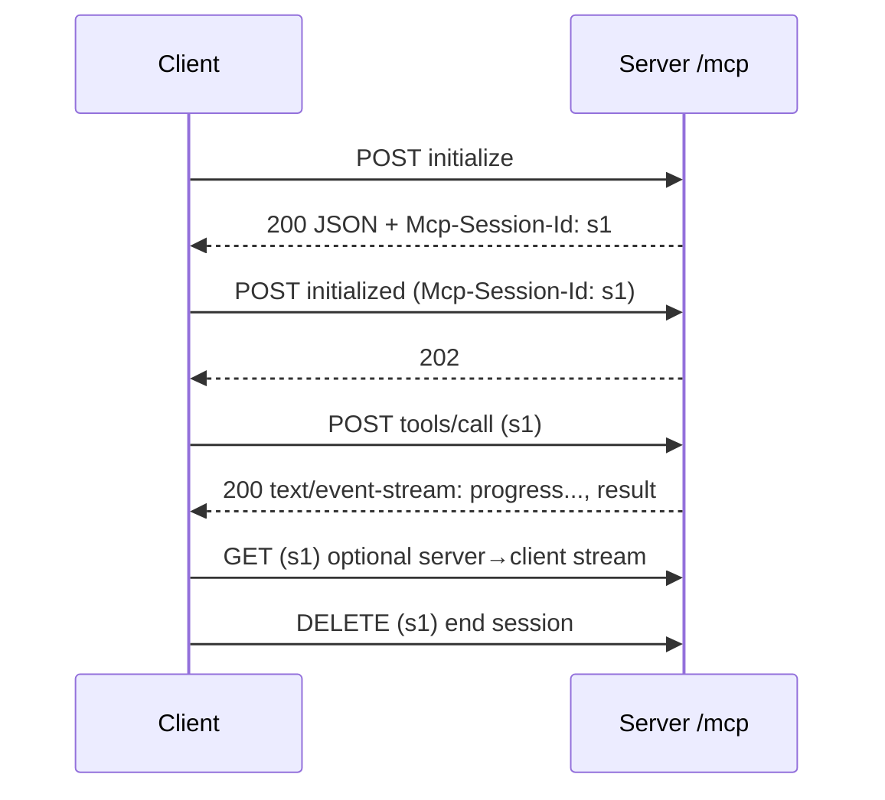

# 4. Streamable HTTP with sessions (2025-03-26 → 2025-11-25)

[← Index](README.md)

One endpoint (`/mcp`). Every client message is a POST. The server may reply with plain JSON **or** an SSE stream for that one request. A session id issued at `initialize` ties requests together.



## Step 1 — initialize

```bash
curl -i -X POST http://localhost:3000/mcp \
  -H 'Content-Type: application/json' \
  -H 'Accept: application/json, text/event-stream' \
  -d '{"jsonrpc":"2.0","id":1,"method":"initialize","params":{
       "protocolVersion":"2025-11-25","capabilities":{},
       "clientInfo":{"name":"curl","version":"1"}}}'
```
```
HTTP/1.1 200 OK
Content-Type: application/json
Mcp-Session-Id: 7f3c9a

{"jsonrpc":"2.0","id":1,"result":{"protocolVersion":"2025-11-25","capabilities":{"tools":{}},"serverInfo":{"name":"demo","version":"1.0.0"}}}
```

## Step 2 — initialized (now carry two headers)

```bash
curl -i -X POST http://localhost:3000/mcp \
  -H 'Content-Type: application/json' \
  -H 'Accept: application/json, text/event-stream' \
  -H 'Mcp-Session-Id: 7f3c9a' \
  -H 'MCP-Protocol-Version: 2025-11-25' \
  -d '{"jsonrpc":"2.0","method":"notifications/initialized"}'
```
```
HTTP/1.1 202 Accepted
```

## Step 3 — a call that streams

```bash
curl -N -X POST http://localhost:3000/mcp \
  -H 'Content-Type: application/json' \
  -H 'Accept: application/json, text/event-stream' \
  -H 'Mcp-Session-Id: 7f3c9a' \
  -H 'MCP-Protocol-Version: 2025-11-25' \
  -d '{"jsonrpc":"2.0","id":2,"method":"tools/call","params":{
       "name":"slow_sum","arguments":{"a":2,"b":3},
       "_meta":{"progressToken":"p1"}}}'
```
```
event: message
data: {"jsonrpc":"2.0","method":"notifications/progress","params":{"progressToken":"p1","progress":50,"total":100}}

event: message
data: {"jsonrpc":"2.0","id":2,"result":{"content":[{"type":"text","text":"5"}]}}
```
The stream closes after the response.

## Step 4 — end the session

```bash
curl -i -X DELETE http://localhost:3000/mcp -H 'Mcp-Session-Id: 7f3c9a'
```

## Crystal: reading a POST that may be JSON or SSE

```crystal
require "http/client"
require "json"

# POSTs one JSON-RPC message; yields every message received
# (notifications, server requests, then the response).
def mcp_post(url : String, body, headers : HTTP::Headers, &)
  h = headers.dup
  h["Content-Type"] = "application/json"
  h["Accept"] = "application/json, text/event-stream"
  HTTP::Client.post(url, headers: h, body: body.to_json) do |res|
    case res.content_type
    when "application/json"
      yield JSON.parse(res.body_io.gets_to_end)
    when "text/event-stream"
      data = String::Builder.new
      res.body_io.each_line do |line|
        if line.starts_with?("data:")
          data << line[5..].lstrip
        elsif line.empty? && !data.empty?
          yield JSON.parse(data.to_s)
          data = String::Builder.new
        end
      end
    end
  end
end
```

## Caveats

1. `MCP-Protocol-Version` header arrived in 2025-06-18. A server receiving no header should assume 2025-03-26.
2. HTTP 404 with a session id means the session expired: re-`initialize` without the header.
3. Session ids are opaque; don't parse them. Visible ASCII only.
4. Notifications and responses POSTed by the client get `202` and no body.
5. A dropped SSE stream is **not** a cancel. Send `notifications/cancelled` explicitly.
6. Servers must validate `Origin` to stop DNS-rebinding attacks on localhost servers.
