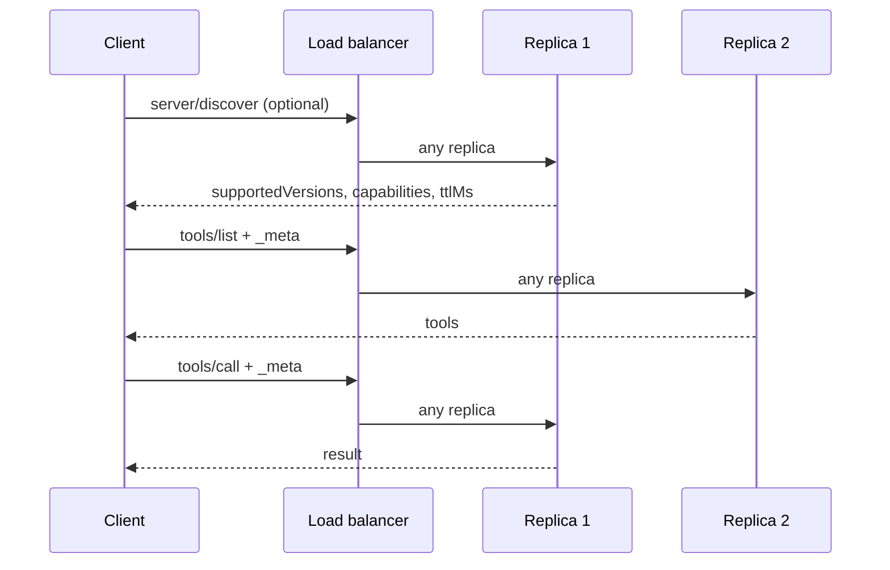

# 5. Stateless (2026-07-28, current)

[← Index](README.md)

No `initialize`, no `notifications/initialized`, no `Mcp-Session-Id`, no `ping`. Every request carries its version and capabilities in `params._meta`. HTTP adds routing headers so proxies need not read the body.



## Required on every request

| Where | Field | Example |
|---|---|---|
| Header | `MCP-Protocol-Version` | `2026-07-28` (must match `_meta`) |
| Header | `Mcp-Method` | `tools/call` |
| Header | `Mcp-Name` | tool/prompt/resource name, when the method has one |
| `params._meta` | `io.modelcontextprotocol/protocolVersion` | `"2026-07-28"` |
| `params._meta` | `io.modelcontextprotocol/clientCapabilities` | `{}` |
| `params._meta` | `io.modelcontextprotocol/clientInfo` | optional, recommended |

## Step 1 — discover (optional for clients, mandatory for servers)

```bash
curl -s -X POST http://localhost:3000/mcp \
  -H 'Content-Type: application/json' \
  -H 'Accept: application/json, text/event-stream' \
  -H 'MCP-Protocol-Version: 2026-07-28' \
  -H 'Mcp-Method: server/discover' \
  -d '{"jsonrpc":"2.0","id":1,"method":"server/discover","params":{"_meta":{
       "io.modelcontextprotocol/protocolVersion":"2026-07-28",
       "io.modelcontextprotocol/clientCapabilities":{},
       "io.modelcontextprotocol/clientInfo":{"name":"curl","version":"1"}}}}'
```
```json
{"jsonrpc":"2.0","id":1,"result":{
  "resultType":"complete",
  "supportedVersions":["2026-07-28"],
  "capabilities":{"tools":{}},
  "ttlMs":3600000,
  "cacheScope":"public",
  "_meta":{"io.modelcontextprotocol/serverInfo":{"name":"demo","version":"1.0.0"}}}}
```

## Step 2 — list tools (same `_meta`, different method header)

```bash
curl -s -X POST http://localhost:3000/mcp \
  -H 'Content-Type: application/json' \
  -H 'Accept: application/json, text/event-stream' \
  -H 'MCP-Protocol-Version: 2026-07-28' \
  -H 'Mcp-Method: tools/list' \
  -d '{"jsonrpc":"2.0","id":2,"method":"tools/list","params":{"_meta":{
       "io.modelcontextprotocol/protocolVersion":"2026-07-28",
       "io.modelcontextprotocol/clientCapabilities":{}}}}'
```

## Step 3 — call a tool (add `Mcp-Name`)

```bash
curl -s -X POST http://localhost:3000/mcp \
  -H 'Content-Type: application/json' \
  -H 'Accept: application/json, text/event-stream' \
  -H 'MCP-Protocol-Version: 2026-07-28' \
  -H 'Mcp-Method: tools/call' \
  -H 'Mcp-Name: add' \
  -d '{"jsonrpc":"2.0","id":3,"method":"tools/call","params":{
       "name":"add","arguments":{"a":2,"b":3},
       "_meta":{"io.modelcontextprotocol/protocolVersion":"2026-07-28",
                "io.modelcontextprotocol/clientCapabilities":{}}}}'
```
```json
{"jsonrpc":"2.0","id":3,"result":{"resultType":"complete",
  "content":[{"type":"text","text":"5"}]}}
```

## Step 4 — wrong version

Send `"2027-01-01"` and get:
```json
{"jsonrpc":"2.0","id":4,"error":{"code":-32022,
  "message":"Unsupported protocol version",
  "data":{"supported":["2026-07-28","2025-11-25"],"requested":"2027-01-01"}}}
```
Pick from `supported` and retry the same request.

## Over stdio

Same JSON, no headers, newline-delimited as in [02](02-stdio-handshake.md). Each line is self-contained.

## Server-to-client notifications

The GET stream and `resources/subscribe` are gone. The client opens a dedicated stream with `subscriptions/listen` (POST, `Accept: text/event-stream`), naming what it wants, e.g. `"notifications":{"toolsListChanged":true}`.

## Caveats

1. Header and `_meta` versions must agree, or the server answers -32020 (HeaderMismatch).
2. Missing required `_meta` keys → -32602, HTTP 400.
3. `ttlMs`/`cacheScope` are required on discover and list/read results. Clients may cache; don't re-discover before every call.
4. Application state ("my basket") must now be an explicit handle the tool returns and the client passes back as an argument.
5. Tools may mark arguments with `x-mcp-header`; the client must copy those values into `Mcp-Param-*` headers.
6. Roots, sampling and logging are deprecated (still work for ≥ 12 months). Don't build new things on them.
