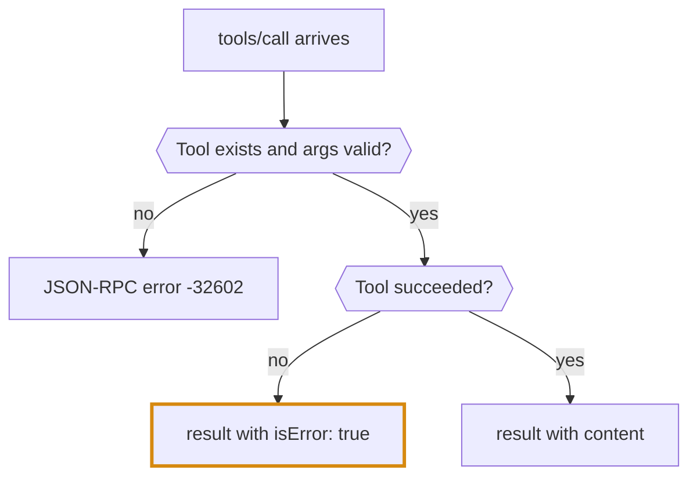

# 6. Tools, resources, prompts

[← Index](README.md)

Bodies below omit the 2026 `_meta` block and transport headers for readability. Add them per [04](04-streamable-http-sessions.md) or [05](05-stateless-2026.md).

| Primitive | Who decides to use it | List | Use |
|---|---|---|---|
| Tool | Model | `tools/list` | `tools/call` |
| Resource | Application | `resources/list`, `resources/templates/list` | `resources/read` |
| Prompt | User | `prompts/list` | `prompts/get` |

Analogy: tools are verbs, resources are nouns, prompts are recipes.

## Tools: list → call, step by step

### Request 1 — list
```json
{"jsonrpc":"2.0","id":1,"method":"tools/list","params":{}}
```
```json
{"jsonrpc":"2.0","id":1,"result":{
  "tools":[{"name":"get_weather","title":"Weather",
    "description":"Current weather for a city",
    "inputSchema":{"type":"object","properties":{"city":{"type":"string"}},"required":["city"]},
    "outputSchema":{"type":"object","properties":{"tempC":{"type":"number"}}},
    "annotations":{"readOnlyHint":true}}],
  "nextCursor":"page2"}}
```

### Request 2 — next page (same method, add cursor)
```json
{"jsonrpc":"2.0","id":2,"method":"tools/list","params":{"cursor":"page2"}}
```
```json
{"jsonrpc":"2.0","id":2,"result":{"tools":[]}}
```
No `nextCursor` means done.

### Request 3 — call it
```json
{"jsonrpc":"2.0","id":3,"method":"tools/call",
 "params":{"name":"get_weather","arguments":{"city":"Oslo"}}}
```
```json
{"jsonrpc":"2.0","id":3,"result":{
  "content":[{"type":"text","text":"{\"tempC\":4}"}],
  "structuredContent":{"tempC":4},
  "isError":false}}
```

### Request 4 — the tool fails
```json
{"jsonrpc":"2.0","id":4,"method":"tools/call",
 "params":{"name":"get_weather","arguments":{"city":"Atlantis"}}}
```
```json
{"jsonrpc":"2.0","id":4,"result":{
  "content":[{"type":"text","text":"Unknown city: Atlantis"}],
  "isError":true}}
```



**Decision:** protocol problems are JSON-RPC errors; tool failures are results with `isError`, so the model can read them and try again.

## Resources

```json
{"jsonrpc":"2.0","id":5,"method":"resources/read","params":{"uri":"file:///notes/todo.md"}}
```
```json
{"jsonrpc":"2.0","id":5,"result":{"contents":[
  {"uri":"file:///notes/todo.md","mimeType":"text/markdown","text":"- buy milk"}]}}
```
Binary contents use `"blob":"<base64>"` instead of `text`.

Templates: `{"uriTemplate":"weather://{city}/today", "name":"daily"}` — RFC 6570 URI templates the client fills in.

## Prompts

```json
{"jsonrpc":"2.0","id":6,"method":"prompts/get",
 "params":{"name":"review_code","arguments":{"lang":"crystal"}}}
```
```json
{"jsonrpc":"2.0","id":6,"result":{"messages":[
  {"role":"user","content":{"type":"text","text":"Review this Crystal code..."}}]}}
```

## Caveats

1. `structuredContent` and `outputSchema` start at 2025-06-18. For older clients, also put serialized JSON in a text block.
2. `inputSchema` is full JSON Schema 2020-12 from 2026-07-28; earlier revisions only promise a plain object schema.
3. Missing resource: -32002 before 2026-07-28, -32602 after. Match both.
4. Cursors are opaque. Don't build them, don't parse them.
5. `title` is for humans, `name` is the identifier (titles arrived 2025-06-18).
