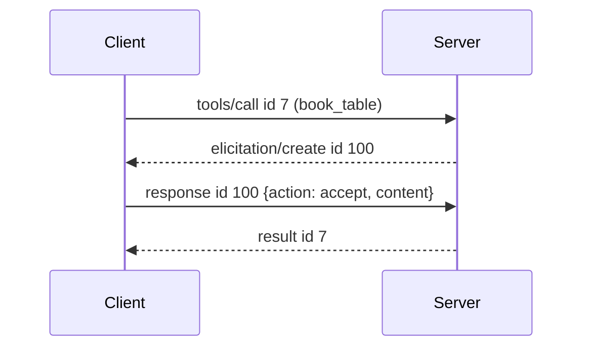
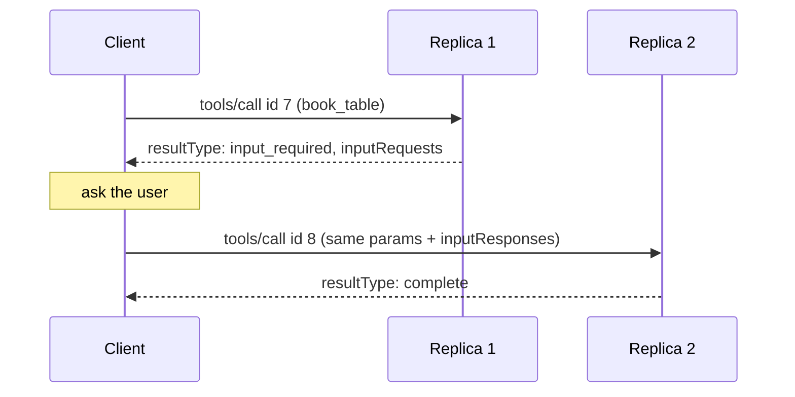

# 7. Asking the client for input

[← Index](README.md)

Sometimes a tool needs something mid-call: user confirmation, a login, a model completion. The two eras solve this differently.

## Handshake era: the server sends a request back

The server issues its own JSON-RPC request while the client's `tools/call` is still open.



Server → client (on the SSE stream or stdout):
```json
{"jsonrpc":"2.0","id":100,"method":"elicitation/create","params":{
  "message":"How many guests?",
  "requestedSchema":{"type":"object","properties":{"guests":{"type":"integer"}},"required":["guests"]}}}
```
Client → server:
```json
{"jsonrpc":"2.0","id":100,"result":{"action":"accept","content":{"guests":4}}}
```
`action` is `accept`, `decline` or `cancel`. The client must have declared `"elicitation":{}` at `initialize`.

Problem: the reply must reach the **same** server process holding the paused call. Sticky sessions again.

## 2026-07-28: multi-round-trip requests (MRTR)

The server returns early saying "I need input"; the client **retries the original request** with answers attached. Like a form returned with a sticky note: "sign here and resubmit".



### Round 1
```json
{"jsonrpc":"2.0","id":7,"method":"tools/call","params":{
  "name":"book_table","arguments":{"restaurant":"Noma"},
  "_meta":{"io.modelcontextprotocol/protocolVersion":"2026-07-28",
           "io.modelcontextprotocol/clientCapabilities":{"elicitation":{}}}}}
```
```json
{"jsonrpc":"2.0","id":7,"result":{
  "resultType":"input_required",
  "inputRequests":{
    "guests":{"method":"elicitation/create","params":{
      "message":"How many guests?",
      "requestedSchema":{"type":"object","properties":{"guests":{"type":"integer"}}}}}},
  "requestState":"eyJyZXN0YXVyYW50IjoiTm9tYSJ9"}}
```

### Round 2 — same request, plus answers keyed the same way, plus `requestState` echoed
```json
{"jsonrpc":"2.0","id":8,"method":"tools/call","params":{
  "name":"book_table","arguments":{"restaurant":"Noma"},
  "inputResponses":{"guests":{"action":"accept","content":{"guests":4}}},
  "requestState":"eyJyZXN0YXVyYW50IjoiTm9tYSJ9",
  "_meta":{"io.modelcontextprotocol/protocolVersion":"2026-07-28",
           "io.modelcontextprotocol/clientCapabilities":{"elicitation":{}}}}}
```
```json
{"jsonrpc":"2.0","id":8,"result":{"resultType":"complete",
  "content":[{"type":"text","text":"Booked for 4."}]}}
```

## Caveats

1. Keys in `inputRequests` are the server's choice; echo them exactly in `inputResponses`.
2. A server may need several rounds. Loop until `resultType` is `complete`.
3. `requestState` is an opaque string: echo it unchanged, never decode it. At least one of `inputRequests` or `requestState` is present. A result with only `requestState` means "retry later" (load shedding).
4. Each value in `inputResponses` is the plain result of the matching method: an `ElicitResult`, a `CreateMessageResult` or a `ListRootsResult`.
5. Requesting input the client didn't declare a capability for → -32021.
6. Sampling (`sampling/createMessage`) works the same way in each era but is deprecated in 2026-07-28.
