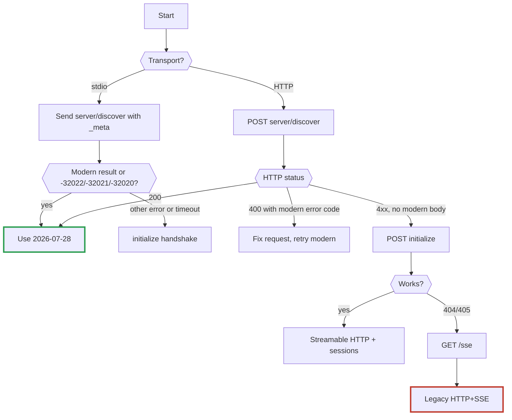
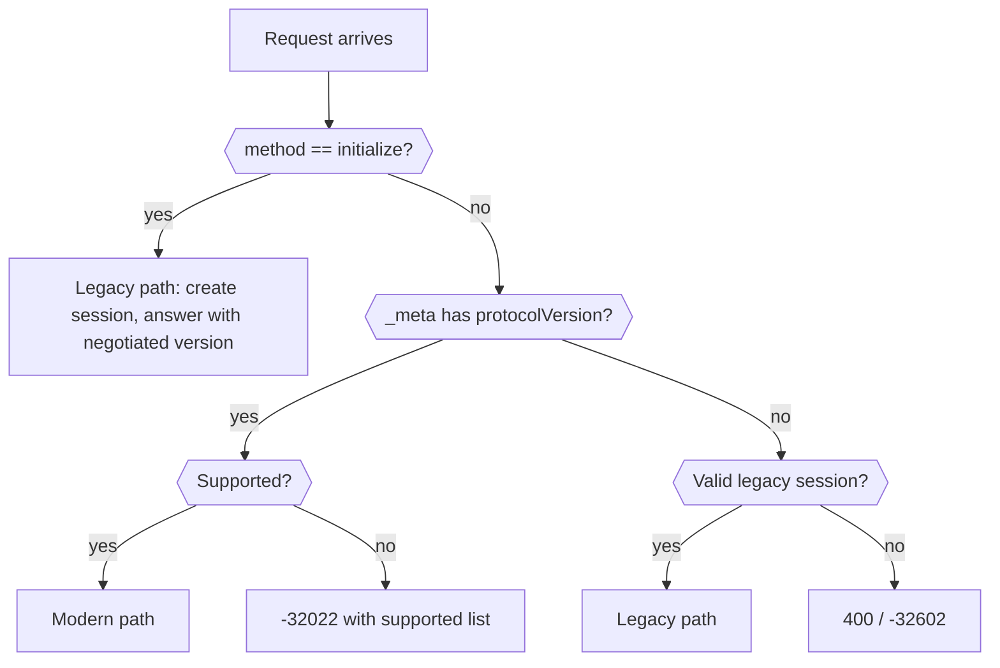

# 8. Compatibility: talking to every era

[← Index](README.md)

## As a client: probe, then fall back



The rule: a **recognised modern error** (-32020, -32021, -32022) means "modern server, your request was wrong". Anything else in a 4xx, or an empty body, means "old server". 401/403/500 keep their HTTP meaning and are not a reason to fall back.

### Point-in-time view: what the client knows after each step (HTTP)

| After | Knows | Headers to send next |
|---|---|---|
| discover → 200 | Modern; versions; capabilities | `MCP-Protocol-Version`, `Mcp-Method`, `Mcp-Name` |
| discover → 400 plain | Legacy | none yet |
| initialize → 200 | Version, session id | `Mcp-Session-Id`, `MCP-Protocol-Version` (if ≥ 2025-06-18) |
| initialize → 405 | Pre-Streamable | switch to GET `/sse` |

## As a server: accept both

Decide per request:



## Crystal: version-aware request builder

```crystal
require "json"

# Builds JSON-RPC params for the negotiated era.
# Modern: merges the required `_meta` keys. Legacy: returns params as-is.
module Envelope
  MODERN = "2026-07-28"

  def self.params(version : String, params : Hash(String, JSON::Any),
                  caps = JSON::Any.new({} of String => JSON::Any)) : Hash(String, JSON::Any)
    return params unless version >= MODERN
    meta = params["_meta"]?.try(&.as_h.dup) || {} of String => JSON::Any
    meta["io.modelcontextprotocol/protocolVersion"] = JSON::Any.new(version)
    meta["io.modelcontextprotocol/clientCapabilities"] = caps
    params.merge({"_meta" => JSON::Any.new(meta)})
  end
end
```

Date-named versions compare correctly as strings: `"2025-11-25" < "2026-07-28"`.

## Caveats

1. Some legacy servers accept unknown methods silently or hang; use a timeout on the stdio probe.
2. Don't mix eras on one connection. Decide once, then stay.
3. Feature checks follow the negotiated version, not the server's latest: a 2026 server speaking 2025-06-18 to you won't offer MRTR.
