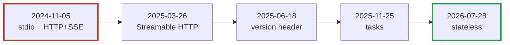

# MCP from the wire up — index

A field guide for implementers. Each linked page is one use case, with raw requests and responses that build on each other.

## Index

1. [JSON-RPC basics](01-jsonrpc-basics.md) — the envelope every message uses
2. [stdio, handshake era](02-stdio-handshake.md) — subprocess + `initialize` (Crystal)
3. [HTTP+SSE (2024-11-05, deprecated)](03-http-sse-legacy.md) — two endpoints
4. [Streamable HTTP with sessions (2025-03-26 → 2025-11-25)](04-streamable-http-sessions.md) — one endpoint, `Mcp-Session-Id`
5. [Stateless (2026-07-28, current)](05-stateless-2026.md) — no handshake, `server/discover`, `_meta`
6. [Tools, resources, prompts](06-primitives.md) — list → call, pagination, errors
7. [Asking the client for input](07-client-input.md) — elicitation/sampling vs. multi-round-trip (MRTR)
8. [Compatibility: talking to every era](08-compatibility.md) — probe and fall back
9. [Caveats and special cases](09-caveats.md)
10. [Brief for an AI coding assistant](10-ai-build-brief.md) — authority, decisions, build order

## The versions you remember

Your memory is right on all three counts: socket-like (stdio), two flavours of HTTP, and a new stable release that changes the model again.

| Revision | Transports | Session model | Headline |
|---|---|---|---|
| 2024-11-05 | stdio, **HTTP+SSE** (GET `/sse` + POST) | Handshake | First stable spec |
| 2025-03-26 | stdio, **Streamable HTTP** (one endpoint) | Handshake + `Mcp-Session-Id` | JSON-RPC batching, OAuth 2.1 |
| 2025-06-18 | same | same + `MCP-Protocol-Version` header | Batching removed; `structuredContent`; elicitation |
| 2025-11-25 | same | same | Tasks (experimental), URL elicitation |
| **2026-07-28** | stdio, Streamable HTTP | **Stateless**, no handshake | `server/discover`, `_meta` per request, MRTR |

Analogy: the handshake era is a phone call (dial, say hello, then talk; hang up and you start over). 2026-07-28 is letters with a return address: every envelope carries everything needed to answer it, so any clerk at the post office can reply.

Red border: deprecated transport still found in the wild. Green: current.

**Question to check yourself:** a load balancer sits in front of three server replicas. Which revisions need sticky routing, and why does 2026-07-28 not?

## Source of truth

The spec repo is [modelcontextprotocol/modelcontextprotocol](https://github.com/modelcontextprotocol/modelcontextprotocol). For each revision:

| Path | Use |
|---|---|
| `schema/<rev>/schema.ts` | Every message type; authoritative |
| `schema/<rev>/schema.json` | Same, as JSON Schema; generate Crystal types or validate test fixtures |
| `schema/<rev>/examples/` | One JSON file per message shape; ready-made `curl -d @file` bodies |
| `docs/specification/<rev>/` | The prose spec (transports, versioning) |
| `seps/` | Why each change was made |

Diff two revisions to see exactly what changed: `diff schema/2025-11-25/schema.ts schema/2026-07-28/schema.ts`.
